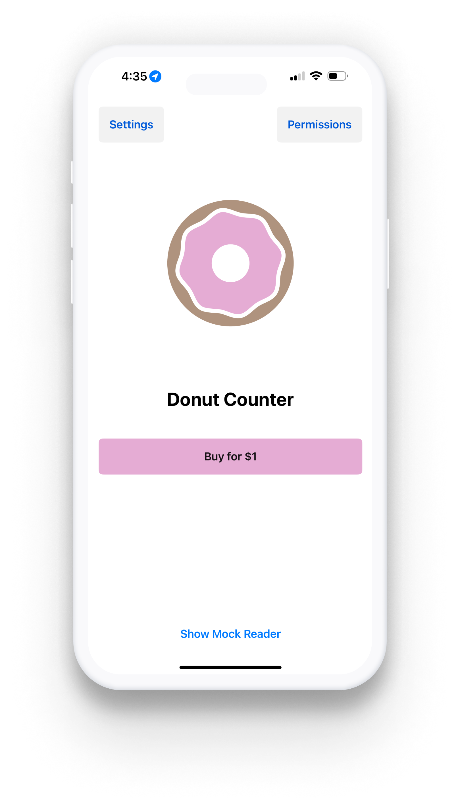
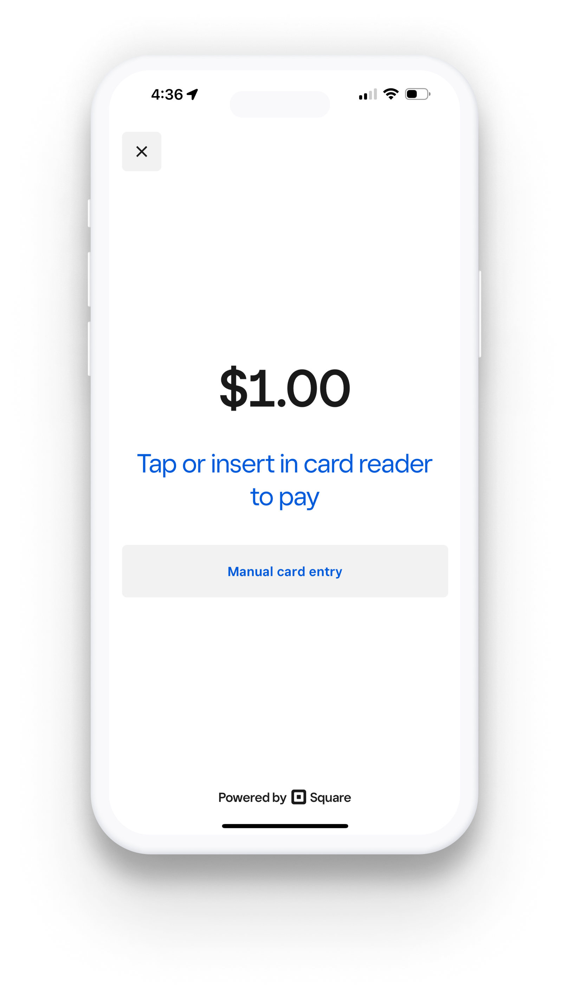
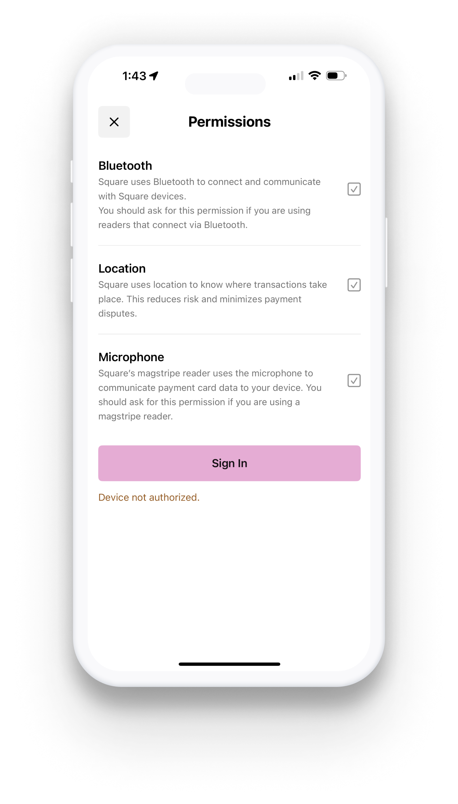
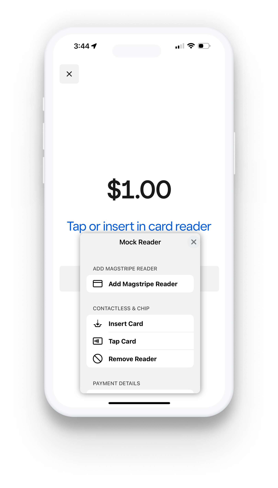

# 🍩 Donut Counter - A Square Mobile Payments SDK Sample App

 

Donut Counter is a sample application for building with the [Square Mobile Payments SDK](https://developer.squareup.com/docs/mobile-payments-sdk) on iOS. The app demonstrates how to install and initialize the SDK in a SwiftUI project as well as utilizing the APIs and user interfaces provided by the SDK to authorize a merchant, pair and manage card readers, and take a payment. To get started, follow the steps below.

## SDK Quick Reference

| Reference                        | Sample App Project Location                   |
| -------------------------------- | ----------------------------------------- |
| ⚡️ Initializing the SDK          | [DonutCounter/AppSession.swift](./DonutCounter/DonutCounter/AppSession.swift) |
| 🔒 Authorizing the SDK           | [DonutCounter/AppSession.swift](./DonutCounter/DonutCounter/AppSession.swift) |
| 💰 Taking a Payment              | [DonutCounter/Screens/Home/HomeView.swift](./DonutCounter/DonutCounter/Screens/Home/HomeView.swift#L155-L182) |
| ⚙️ Presenting Settings Screen    | [DonutCounter/Screens/Home/HomeView.swift](./DonutCounter/DonutCounter/Screens/Home/HomeView.swift#L128-L136) |
| 💳 Presenting MockReaderUI       | [DonutCounter/Screens/Home/HomeView.swift](./DonutCounter/DonutCounter/Screens/Home/HomeView.swift#L210-L228) |

# Get Started

## 1. Review requirements

### Assumptions
The example app makes the following assumptions:

* You have read the [Mobile Payments SDK "Build on iOS"](https://developer.squareup.com/docs/mobile-payments-sdk/ios) documentation. The example app focuses on demonstrating how the Square Mobile Payments SDK works by using all of the provided user interfaces of the SDK.
* You have a Square account enabled for payment processing. If you have not
  enabled payment processing on your account (or you are not sure), visit
  [squareup.com/activate](https://squareup.com/activate).

### Prerequisites

* Confirm your environment meets the Square Mobile Payments SDK build requirements listed in the [root README](../README.md) for this repo.
* Clone this repo (if you have not already):
  `git clone https://github.com/square/mobile-payments-sdk-ios`

## 2. Get application credentials
In your [Developer Dashboard](https://developer.squareup.com/apps), create an application or open an existing one you would like to use. If this is your first time creating an application with Square, you can review this [Get Started](https://developer.squareup.com/docs/square-get-started) guide for more information.

On the application's Credentials page, toggle the environment you'd like to use at the top (Production/Sandbox). Sandbox credentials will allow you to take mock payments with a mock reader. Make note of:
* **Application ID**
* **Access Token**

Click "Locations" in the left navigation and make note of the Default Test Account's **Location ID** as well. These values will be used in the next step.

## 3. Configure the SDK
Enter the application ID, access token, and location ID in the app's **Square account** form after launch. Credentials are not bundled or committed. The form remembers non-secret identifiers and currency; the SDK manages the authorized session. See the [account and currency guide](./DonutCounter/README.md).

## 4. Run the app
1. Open `DonutCounter.xcodeproj` in Xcode
2. Select the `DonutCounter` target found at the top of Xcode.
3. Select your desired device and click the Run button.

## 5. Request required permissions
On the first install of the application, you will be required to grant various device permissions in order for the SDK to be fully functional.

The Square account form lists the required permissions. Tap each permission row to grant access. Granted permissions show a checkmark. You can return to this form using **Account** on the home screen.

## 6. Authorize the SDK
Tap **Sign in** in the Square account form. Successful authorization opens the amount keypad. A failed sign-in shows an error in the form. Use **Account** to sign out or change credentials. Changing application ID requires closing and reopening the app; seller/token/location changes under the same application ID sign out before signing in again.

## 7. Pair a reader
Depending on what environment you are authorized in, the steps for pairing a reader will differ. Follow the steps below according to your current environment.

### Production
In a production environment, you are only able to pair actual Square card readers. Mock readers do not work in a production environment.

To pair a reader:
1. Tap the `Settings` button found in the top left corner of the application. This will display the Square provided settings screen allowing you to manage and pair readers.
2. Tap the "Pair a reader" button.
3. Follow the instructions on the dialog that present on how to pair your contactless reader to your device.
4. After a successful pair, you should see the reader available in the `Devices` tab of the settings screen.
5. The reader is ready to be used for payments once the state updates to `Ready`.

### Sandbox
Sandbox accepts sandbox credentials and supports online-only processing. This lab build does not link MockReaderUI, so it does not expose mock-reader controls. A developer can add the separate MockReaderUI product to a debug-only target when mock-reader payment testing is needed; never include it in a distributed release.

## 8. Take a Payment

To process a payment, follow these steps:

1. Select a currency matching the authorized location, enter an amount, and tap **Charge**. Changing currency clears the amount. The app then presents the SDK payment prompt.

2. Depending on your environment:
   - **Production Environment**: Use your paired Square reader to tap, insert, or swipe a payment card.
   - **Sandbox Environment**: Tap the mock reader button and choose an option to tap, insert, or swipe a mock payment card.

